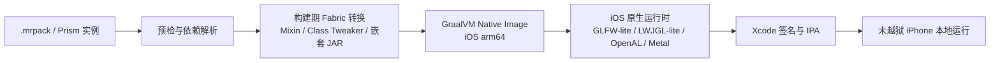

# Native Craft Launcher

> 2026-11-15 集成决策：主要研发路线采用 [ADR-009](docs/evidence/ADR-009.md)：Minecraft 26.1.2 原生 OpenGL → OSMesa/Zink → MoltenVK → Metal/CAMetalLayer；保留原生 Metal 模式。Apple Silicon macOS 的 desktop/ GUI 与真实 IPA 按 [集成审计](docs/integration/GL41_BRANCH_AUDIT.md) 推进，真机验收前维持 experimental。

本轮已构建 ARM64 macOS 应用，并通过 Tauri 命令接口完成真实 AOT → iOS 链接 → IPA 校验。开发签名测试应用安装成功；锁屏阻断原生 GUI 交互和真机游戏启动。产物、哈希、测试和未完成门槛见 [交付记录](docs/integration/GL41_DELIVERY.md)，使用方式见 [GUI 构建指南](docs/integration/GL41_GUI_BUILDING.md)。


**在未越狱 iPhone 上本地运行 Minecraft Java Edition + Fabric 的实验性工程。默认线为 26.1.2 / Java 25，并行支持 1.21.1 / Java 21。**

Native Craft Launcher（简称 NCL，仓库代号 MCFAO）的目标是让用户在 Mac 上导入 `.mrpack` 或 Prism Launcher 实例，经过依赖解析、构建期 Fabric 转换、Java AOT 编译和 iOS 签名后，得到一份可以在普通 iPhone 上本地游玩的 IPA。游戏逻辑、渲染和存档都在手机上执行，不需要 Java JIT、越狱或电脑串流。

> **项目状态：实验性研发阶段。** 工具链和 Fabric 静态化门槛已经打通，原版单人玩法在 iOS 模拟器上通过，但完整真机可玩、整合包功能覆盖和性能验收仍未完成。当前产物不能称为 v1 正式版。

本项目是非官方项目，与 Mojang Studios、Microsoft 没有关联，也未获其认可。仓库不包含 Minecraft 游戏本体、官方资源或用户存档。

## 要解决的问题

把 Java 版 Minecraft 搬到 iOS，难点不只是换一个渲染后端：

- **闭世界编译与 Fabric 动态机制冲突。** Mixin、Class Tweaker、嵌套 JAR、入口点和运行期类生成都发生在传统 JVM 的加载阶段，而 GraalVM Native Image 要求在构建时尽可能确定全部类型。项目使用真实 Fabric Loader 在构建期执行转换，并把无法静态化的 Mod 明确报告或排除。
- **桌面图形栈不能直接复用。** Minecraft 使用 OpenGL、GLFW、LWJGL 和 OpenAL（26.1.2 为 LWJGL 3.4.x，1.21.1 为 3.3.3）；iOS 只提供 Metal。项目实现了 GLFW-lite、LWJGL-lite、OpenAL 适配和 Metal 后端，并在构建期把游戏着色器翻译成 Metal Shading Language。
- **iOS 签名和分发边界。** 免费 Personal Team 的描述文件通常 7 天过期；包含 Minecraft 代码的 IPA 不能作为公开通用安装包分发。

项目的硬约束是 **Fabric Only**、在普通未越狱 iPhone 上不依赖 JIT 运行，以及两条并行构建线各自的版本契约：**26.1.2 / Java 25**（默认，发行即 official 未混淆命名空间）与 **1.21.1 / Java 21**（发行即混淆，需构建期 obfuscated → intermediary → official 映射）。26.1.2 仍是默认线与 v1 验收目标；1.21.1 是并行支持的第二条线。

## 当前进度

| 门槛 | 状态 | 已经证明什么 |
| --- | --- | --- |
| A0 / A1 | **PASS** | Mac 上 Java 25 + Fabric 能启动真实客户端；Java 25 小程序经 AOT、签名后能在普通 iPhone 上无 JIT 独立运行。以上为 26.1.2 线的结论，1.21.1 单独记录 |
| B0 / B1 | **PASS** | 真实 Fabric Mixin、Class Tweaker、嵌套 JAR 和入口点能在构建期转换，iOS 上的行为与桌面基线一致 |
| C 原版游戏 | 模拟器 **PASS**，真机 **BLOCKED** | 模拟器已出现真实主菜单，可创建世界、移动、取放和破坏方块、打开物品栏、保存并重进 |
| D 整合包 | **部分完成** | 41 个根 JAR 的整合包在模拟器进入世界，83 个入口点完成派发；真机整合包验收仍未完成 |
| E 性能与稳定性 | **BLOCKED** | 已有初步真机帧数据，但完整性能、温度和 30 分钟稳定性验收尚未完成 |

### Minecraft 1.21.1 并行线

1.21.1 / Java 21 是新增的并行构建线。最新包 MC1211-r7-20261122 已构建、签名、覆盖安装并启动，用户确认已进入世界；日志显示 609 个区块解码与持续渲染、实体包更新。r7 修复了 r6 现场线程栈确认的聊天公钥等待，保留需要时的签名校验，4 项聊天回归通过。存档重进、触摸与声音因用户暂时无法继续测试而未验证，gateC0 仍为 BLOCKED。当前已通过的构建期环节：

- 官方客户端输入按哈希核验，assetIndex 为 `17`（26.1.2 为 `30`）。
- 正式映射入口 `prepare_game_version.py` 经 Fabric 管线完成 obfuscated → intermediary → official 映射，8,269 类，intermediary 未匹配类与成员均为 0，结果缓存在 `cache/version-adaptation/1.21.1/remapped/`。
- `PREPARED` 输入、GL41 客户端补丁、GLFW 原生子集（`NATIVE_SUBSET_BUILT`，宿主状态夹具 PASS）、GL41 运行时（源码构建固定 Mesa 25.0.7 + 固定 MoltenVK）、OpenGL JNI shim 与 LWJGL 静态 JNI 桥均已完成；26.1.2 回归 `lwjgl-26-regression-r4` 同样通过，宿主 Window/Image 夹具 PASS。
- Fabric API 0.116.18+1.21.1 的构建期导出覆盖 50 个模块，`excludedMods` 为空：`EventFactoryImpl` 的动态代理路径与 Indigo 插件查询已按审计哈希静态收敛，不再整模块排除。该结论仅限构建期导出，`semanticCompatibility` 自述不构成功能等价证明，`runtimeVerified` 为 false。
- 原版 AOT 已生成可重定位对象并完成运行库、链接与 Xcode 输入暂存，产物为 `arm64-apple-ios17.0`；链接状态为 `LINKED_WITH_UNSUPPORTED_ENTRYPOINTS`，未解析符号为空，`_Java_com_sun_management_internal_OperatingSystemImpl_initialize0` 以显式 unsupported stub 收尾；设备上正是走到这个 stub 才 abort。
- Fabric 整合包线最新签名 IPA 为 NCL-game-MC1211-r7-20261122.ipa（fabric-aot-world-r7，SIGNED_DEVICE_APP，841,066,436 字节，SHA-256 96ca4b15…），50 个模块零排除，client-graph.dylib UUID DDA1DFC0-D5AA-3D5F-9CB4-4A54B8A948D6。签名、描述文件设备覆盖、测试标识一致性均 PASS；进世界与设备日志证据在 world-evidence-r7/。
- 原版签名探针（`MC1211-r1-20261122`，assetIndex 17）已装机并由用户手动运行：镜像与六个原生库加载成功，虚拟地址探针通过，但 `run_main` 返回 1，`com.mojang.logging.LogUtils` 初始化失败，被 `CrashReport` 的再次初始化覆盖（当时无菜单或世界证据；后续 r4 已进入主菜单）。
- 隔离日志探针（`com.mojang:logging` 1.2.7、`log4j-slf4j2-impl` 2.22.1、SLF4J 2.0.9、Log4j 2.22.1）把根因拆成几步：AOT 镜像缺少 `DefaultFlowMessageFactory`、`ParameterizedMessageFactory` 与 `core.impl.Log4jContextFactory` 的无参构造反射元数据（JVM 通过、原生 AOT 复现 `NoSuchMethodException`）；补齐后 `LogUtils` 能初始化，但 Log4j 2.22.1 的 `ServiceLoaderUtil.callServiceLoader` 又因动态 lambda 工厂回退到 `SimpleLoggerContext`。已新增 `compiler/logging-tools` 与 `tools/prepare_logging_aot.py`，把该方法按哈希守卫改写为直接 `ServiceLoader.load` 并保留错误处理；再补 7 个 `PatternConverter.newInstance` 与 `Log4j2Plugins.dat` 后，`r10` 两次原生探针均 exit 0，拿到真实 core `LoggerContext` 并正确输出 `[main/ERROR] logging-probe: formatted-message`，无 `StatusLogger` 报错，`runtime-control` 与 `sandbox-probe` 分别为 `CONTROL_PASS`、`B0_SANDBOX_PASS`。
- 这些修复已随 `MC1211-r2-20261122` 进入设备构建，并且确实推进了启动：`run_main argc=26`，`Main.main` 进入 `GameLoadTimesEvent.<clinit>` → `LogUtils.getLogger`，没有再出现此前的反射初始化错误（这只说明越过了反射失败；r2 在格式化输出之前就 abort，不足以证明完整格式器在设备上验证通过）。新的失败点是 `LoggerContext.start` 默认启用 JMX，`Server.reregisterMBeansAfterReconfigure` 调用 `Java_com_sun_management_internal_OperatingSystemImpl_initialize0` 这个显式 unsupported stub，打印 `unsupported JVM native entrypoint reached` 后 `FATAL signal 6`。日志在 `startup-evidence-r2/device-r2-first-check/`。关闭可选 JMX 走的是 iOS 运行时启动参数，不是构建期静态改写：`ios/C0Harness/main.m` 的 `run_main` 参数表无条件加入 `-Dlog4j2.disable.jmx=true`，日志库字节码与 AOT 配置不变。配套校验三处：启动器夹具断言参数存在、模拟器 XCTest 断言日志含 `MCFAO_JMX_DISABLED_ARGUMENT_PASS`、隔离探针在禁用 JMX 后仍要求真实 core `LoggerContext`、正确格式化输出与空 `MBeanServer`。宿主 JVM、macOS Native Image 与模拟器 XCTest 已通过（证据 `startup-evidence-r3`），iOS 设备尚未运行。
- `MC1211-r4-20261122` 用构建期 `GL.create()` 定点改写（`tools/prepare_opengl_aot.py` + `PatchOpenGLStartup.java`，`GL.class` SHA-256 固定）解决了 r3 卡在 `GL.<clinit>` 的失败：设备上进入主菜单，GL41/Zink 持续输出 `perf fps` 36–55、`display fps` 52–57。创建世界失败：服务器线程 `java.lang.InternalError: Flight Recorder is not supported on this VM`（`WorldLoadFinishedEvent.<clinit>` → `JfrProfiler.onWorldLoadedStarted` → `MinecraftServer.loadLevel`），`stopServer` 随后 `NullPointerException`。r5 在构建期选择 Minecraft 自带 `NoOpProfiler`（`JvmProfiler.class` 哈希在 mapped 与 split client 上一致）。隔离对照 `world-evidence-r5/result.json` 为 `jvm: PASS`、`native: PASS`、`originalJvm: JFR_SELECTED`、`sandbox: B0_SANDBOX_PASS`，`scope` 明确 no world execution；完整构建 `fabric-aot-world-r5` 已签名、装机并启动，用户进入主菜单后点击进入世界即闪退。设备日志 `run-1795337349403-MC1211-r5-20261122.log` 停在 `Minecraft.doWorldLoad` → `ServerConnectionListener.startMemoryChannel` → Netty shaded JCTools `UnsafeAccess.fieldOffset`，根因 `NoSuchFieldException: producerIndex`，世界未进入。r6 按实际 Netty 4.1.97 字节码补齐 9 个 JCTools Unsafe 字段与 3 个 `ResourceLeakDetector` 方法查询，隔离 JVM、macOS Native Image 本地通道探针与 3 项自动化测试 PASS（`world-evidence-r6/netty-verification.json`）；完整构建 `fabric-aot-world-r6` 已签名、装机并启动，用户手动点击进入世界后停在 `Loading terrain`，世界仍未进入。 r7 随后按现场 Java 线程栈修复聊天公钥等待，用户确认进入世界；存档重进等验证尚未运行。
- 启动器失败界面有独立的模拟器证据：XCTest `testLauncherReportsRuntimeFailure` 在 `LauncherFailure-r2.xcresult` 中通过，验证入口返回 1 时的失败文案、重开按钮禁用、超 256 KiB 日志的头尾保留与 `Done`。它只证明失败能被如实呈现，不涉及游戏启动。

完整事实、命令与限制见 [1.21.1 适配状态](docs/compatibility/MINECRAFT_1211.md)。

当前兼容矩阵覆盖 127 个 Mod 条目：

| 状态 | 数量 | 含义 |
| --- | ---: | --- |
| `BLOCKED` | 13 | 已确认无法进入闭世界，或平台级不可用 |
| `BUILD_PASS` | 56 | 类已进入 AOT 镜像，不等于 Mod 能正常运行 |
| `LOAD_PASS` | 57 | 入口点派发完成，初始化未抛异常 |
| `FUNCTION_PASS` | 1 | 实际功能在游戏内被观察到（目前只有 Jade 的方块提示框） |

最新进展（2026-11-14）：修正了 PROFILE 诊断包的运行库打包问题，build 7 已通过链接、签名和 IPA 内容校验；另一个 Metal vsync 修复包已签名导出，但尚未在真机上运行验证。详见 [STATUS](docs/STATUS.md)。

## 实现路线



每轮构建都会保留命令、输入哈希、日志和产物指纹。构建成功、模拟器启动或签名通过都不能代替真机可玩证据；Gate 的判定标准见 [ACCEPTANCE](docs/ACCEPTANCE.md)。

## 仓库结构

| 目录 | 内容 |
| --- | --- |
| [compiler](compiler) | Fabric 静态化、方法拆分、Metal 后端、着色器翻译、反射配置 |
| [ios](ios) | A1/B1/C0 测试宿主、GLFW-lite、Metal bridge、启动器和诊断工具 |
| [interop](interop) | Java 与 iOS 原生层之间的窄接口、探针和测试夹具 |
| [tools](tools) | 预检、AOT 构建、链接、打包、签名和日志分析 |
| [tests](tests) | Python 回归、Java 测试和原生测试 |
| [docs](docs) | 产品、架构、Gate、兼容矩阵、构建说明和证据索引 |
| [ci](ci) | GitHub Actions、CircleCI 和云端构建脚本 |
| `artifacts/` | 本地构建产物与实验证据，体积很大，不属于源码 |

Mac 端提供 [`desktop/`](desktop) 的 NCL Builder（Tauri 工作台）（游戏内容 → 资源管理 → 构建环境 → 开发签名 → 确认构建），底层仍调用 [`./mcfao`](mcfao) 命令行与 `tools/` 下的 Python 编排。工作台可执行真实 AOT、开发签名、IPA 导出与校验；真机安装、游玩和存档保留按 [验收标准](docs/ACCEPTANCE.md) 独立验证。

## 快速开始

### 前置条件

- Apple Silicon Mac，安装 Xcode 27.2 和对应 iPhoneOS SDK
- Python 3.11+
- GraalVM CE 25.0.2
- 用户自己合法获取的 Minecraft Java 客户端（26.1.2 或 1.21.1）、对应版本的资源与 Fabric 依赖
- 用于真机安装的 Apple 开发签名配置
- 充足的磁盘空间：编译缓存与构建产物按整合包规模可能占用数十 GiB，工作台会按目录分别做空间预检

首次构建需要先准备工具链、图形库、游戏资源和本机配置；仓库不提供游戏本体，也不存在从空目录一键生成 IPA 的脚本。

```bash
git clone https://github.com/AOTFASTLNX/MCFAO.git
cd MCFAO

python3 -B tools/bootstrap_toolchain.py
python3 -B tools/fetch_upstream.py
```

按照 [BUILDING](docs/BUILDING.md) 创建 `mcfao.local.json`，填入本机的游戏版本元数据、资源目录和已构建的图形/音频产物路径，然后运行：

```bash
./mcfao doctor --config ./mcfao.local.json

./mcfao build --version 26.1.2 --loader vanilla --target ios-arm64 \
  --config ./mcfao.local.json --output artifacts/mcfao/my-vanilla

./mcfao verify --target ios-arm64 --output artifacts/mcfao/my-vanilla
```

Fabric 整合包先做元数据预检，再对已审计的输入执行转换和完整构建：

```bash
./mcfao build --version 26.1.2 --loader fabric --target ios-arm64 \
  --config ./mcfao.local.json --mods <mods 目录> \
  --prepare-only --output artifacts/mcfao/my-fabric-metadata

./mcfao build --version 26.1.2 --loader fabric --target ios-arm64 \
  --config ./mcfao.local.json --mods <已审计的 mods 目录> \
  --audited-mods --output artifacts/mcfao/my-fabric
```

1.21.1 使用同一组命令，只把版本换成 `1.21.1`，并需要在配置里提供该版本自己的 `versionProfiles` 条目（`prepared`、`versionMetadata`、`assets`、`glfw`、`lwjgl`、`gl41`、`lwjglOpengl`）：

```bash
./mcfao build --version 1.21.1 --loader vanilla --target ios-arm64 \
  --config ./mcfao.local.json --output artifacts/mcfao/my-vanilla-1211
```

导出 IPA：

```bash
./mcfao export --target ios-arm64 --build artifacts/mcfao/my-vanilla \
  --export-options ios/C0Harness/ExportOptions.plist \
  --output artifacts/mcfao/my-vanilla-ipa
```

### 测试

```bash
python3 -B -m unittest discover -s tests -v
```

部分用例依赖本机已有的 `artifacts/` 构建产物、Xcode 或测试设备；没有这些输入时相关测试不会代表真机结论。测试边界和图形/设备验证命令见 [BUILDING](docs/BUILDING.md)。

## 文档导航

| 文档 | 内容 |
| --- | --- |
| [PRODUCT](docs/PRODUCT.md) | 产品定位、Mac/iOS 功能和明确非目标 |
| [DESKTOP](docs/DESKTOP.md) | 实验版跨平台桌面工作台：源码、能力边界与验证结果 |
| [ARCHITECTURE](docs/ARCHITECTURE.md) | 技术事实、建议流水线和风险登记 |
| [TECHNICAL_GATES](docs/TECHNICAL_GATES.md) | A0 到 E 的可执行门槛和停止条件 |
| [ACCEPTANCE](docs/ACCEPTANCE.md) | 验收清单、测试矩阵和发布标准 |
| [STATUS](docs/STATUS.md) | 当前状态、历史实验和最新证据 |
| [BUILDING](docs/BUILDING.md) | 工具链、构建、签名、模拟器和真机命令 |
| [FABRIC_AOT](docs/FABRIC_AOT.md) | Fabric 静态化、Mixin、嵌套 JAR 和闭世界处理 |
| [MOD_COMPATIBILITY_MATRIX](docs/MOD_COMPATIBILITY_MATRIX.md) | 逐 Mod 兼容状态和证据 |
| [SECURITY_AND_DISTRIBUTION](docs/SECURITY_AND_DISTRIBUTION.md) | 不可信输入、授权、签名和再分发边界 |
| [REVIEW_REPORT](docs/REVIEW_REPORT.md) | 架构审查、已核对事实和严重遗漏 |
| [证据索引](docs/evidence/README.md) | 工具链、A1/B1 和图形实验的原始记录 |

## 证据与判定原则

- 所有结论必须来自真实执行。未执行的测试写 `NOT RUN`，无法继续的 Gate 写 `BLOCKED`。
- 模拟器结果不替代真机结果；构建成功不替代启动成功；签名成功不替代安装和游玩。
- 一个 Mod 的 `BUILD_PASS` 只说明类进入了镜像，必须再有入口点日志（`LOAD_PASS`）和游戏内行为证据（`FUNCTION_PASS`）。
- 运行期动态生成类、动态代理、JNI 原生加载等能力如果无法在构建期封闭，必须明确报告或排除，不能静默跳过。

## 安全、授权与分发

- 不要提交 Minecraft 客户端、官方资源、用户存档、访问令牌或签名私钥。
- `.mrpack`、Prism 实例、Mod JAR、Gradle 构建脚本和 Mixin 插件都可能不可信。默认不执行未隔离的第三方构建代码，并限制 ZIP 路径、展开体积和下载来源。
- 含 Minecraft 代码或资源的 IPA 仅供用户本机构建和安装，不作为公开 Release 或通用安装包分发。
- 免费 Personal Team 的签名有效期和重装后的存档保留需要单独验证；工具不保存个人签名证书。
- iOS 控制层移植自 Amethyst-iOS（GPL-3.0），因此包含它的 App 以 GPL-3.0 分发，见仓库根 LICENSE 与
  [控制层来源](ios/C0Harness/Control/NOTICE.md)。其余第一方代码未附带开源许可证；复用或再分发前
  请先联系维护者确认授权。

## English overview

Native Craft Launcher (NCL) is an experimental build pipeline and iOS runtime for Minecraft Java Edition with Fabric. It runs two parallel build lines: 26.1.2 / Java 25 (default) and 1.21.1 / Java 21. It performs Fabric class transformation at build time, compiles the client ahead of time to iOS arm64, replaces the desktop graphics/audio stack with native iOS adapters and a Metal backend, and produces a locally signed app. It does not use JIT, jailbreak, cloud streaming, or a desktop game server. The project is under active research: toolchain and Fabric gates A0/A1/B0/B1 pass, vanilla single-player works in the iOS Simulator, but full device gameplay, modpack functional coverage, and performance acceptance remain incomplete.
